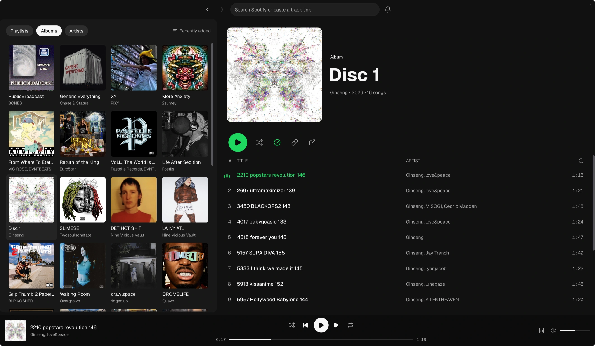

# spoti

lightweight native desktop client for [spotify](https://www.spotify.com)

<div>
	<picture>
		<source
			srcset=".github/screenshots/dark.webp"
			media="(prefers-color-scheme: dark)"
		>
		<source
			srcset=".github/screenshots/light.webp"
			media="(prefers-color-scheme: light)"
		>
		
	</picture>
</div>

## features

- library browsing, search, and local playlist pins
- album details, artist discographies, and recent music from followed artists
- save music and add or remove tracks from playlists
- persistent playback queues, seeking, shuffle, and repeat
- spotify connect with playback transfer and remote controls
- cached artwork and encrypted audio
- light and dark themes

## built with

- [odin](https://odin-lang.org/)
- [sdl3](https://www.libsdl.org/)
- [clay](https://github.com/nicbarker/clay)

## install

### arch

```sh
paru -S spoti-bin
```

### macos

```sh
brew install --cask hyperpuncher/tap/spoti
```

## development

> requires odin, just, and the [native dependencies](docs/development.md)

```sh
just build
just run
just test
```

> requires spotify premium for local playback

## documentation

- [development and dependencies](docs/development.md)
- [spotify setup and limits](docs/spotify.md)
- [architecture and decisions](docs/architecture.md)
